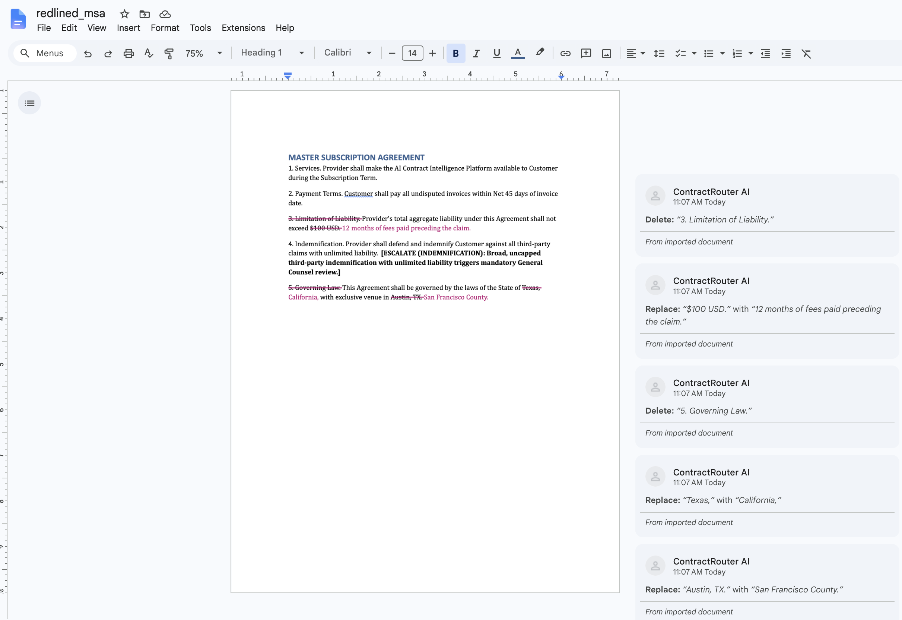

# ContractBench-Inspired OOXML Redline & Escalation Router

A lightweight prototype exploring two core challenges in AI-assisted contract review (inspired by Ivo's [ContractBench](https://www.ivo.ai/research/ivo-micro1-contractbench) research):
1. **Judgment Before Editing (`EDIT` vs. `PRESERVE` vs. `ESCALATE`):** Standard LLMs over-redline acceptable fallback clauses and silently rewrite high-risk terms instead of escalating to human counsel.
2. **Surgical Word-Level OOXML Track Changes:** Rather than replacing whole paragraphs, this pipeline computes token-level diffs (`difflib.SequenceMatcher`) and injects native `<w:del>` and `<w:ins>` OOXML nodes while preserving paragraph properties (`<w:pPr>`).



## How It Works (Inputs → Pipeline → Outputs)

* **Inputs:**
  * `sample_msa.docx`: A 5-clause Master Subscription Agreement containing standard boilerplate, acceptable fallback terms, playbook violations, and high-risk escalation triggers.
  * `playbook.json`: Deal context (`ACV: $120,000`, `Tier: Enterprise`) paired with negotiation boundaries (`standard_position`, `acceptable_fallback`, and `escalation_trigger`).
* **Pipeline:**
  * **Single-Pass Batch Judgment (`Gemini 3.8 Flash` + `Pydantic`):** Evaluates all clauses in a single schema-enforced JSON call, routing each clause to `PRESERVE` (restraint on acceptable fallbacks like Net 45 for Enterprise), `EDIT` (authorized surgical fixes), or `ESCALATE` (mandatory human counsel sign-off for uncapped liability).
  * **Token-Level Diff & OOXML Injector (`python-docx` + `difflib`):** Wraps only modified tokens in native `<w:del>` and `<w:ins>` Track Changes nodes with author attribution (`ContractRouter AI`) and ISO-8601 timestamps.
* **Outputs:**
  * Terminal audit log detailing per-clause routing actions and commercial rationale.
  * `redlined_msa.docx`: Opens directly in Microsoft Word, Apple Pages, or Google Docs with native accept/reject redlines intact.

## Quickstart

```bash
python3 -m venv venv && source venv/bin/activate
pip install -r requirements.txt
cp .env.example .env  # Add your free GEMINI_API_KEY from aistudio.google.com
python router.py